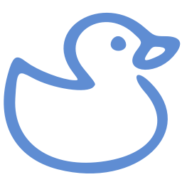

# RDCore.Web
<sup>_This document is available in [English](./README.md)_</sup>


## Avant de commencer.
> 👋 Bonjour! Nouveau ici? _Rubberduck_ a toujours été une initiative open-source. **RDCore l'honore avec une formule Open-Core**.  
> <small>Voir [rubberduckvba.ca](https://rubberduckvba.ca) pour plus d'informations.</small>

Ce dépôt est celui de **RDCore.Web**, le cadriciel web de [RDCore](https://github.com/rubberduck-vba/RDCore), sous **⚖️GPLv3 ou toute version ultérieure**. RDCore.Web sert les modules de classe d'un projet RD-VBA au moyen d'ASP.NET Core. Des annotations Rubberduck comme `'@Controller`, `'@HttpGet` et `'@Authorize` décrivent les points de terminaison, et l'interface peut être toute application Node.js.

Le modèle du langage RD-VBA vient du paquet [RDCore.SDK](https://github.com/rubberduck-vba/RDCore.SDK). Ce que vous construisez avec RDCore.Web vous appartient (voir [NOTICE.md](NOTICE.md)).

## État du projet
RDCore.Web est en cours de mise en place. Le dépôt a sa solution, sa compilation et ses tests; le cadriciel lui-même n'est pas écrit.

## La solution

| Projet | Ce que c'est |
|---|---|
| `RDCore.Web` | La bibliothèque du cadriciel, et le paquet NuGet du dépôt. Elle s'appuie sur RDCore.SDK et ASP.NET Core. |
| `RDCore.Web.Host` | L'hôte ASP.NET Core qui sert une application. |
| `RDCore.Web.Tests` | Les tests (MSTest). |

## Compiler à partir des sources

Avec le [SDK .NET 11](https://dotnet.microsoft.com/download/dotnet/11.0), à la racine du dépôt :

```powershell
dotnet build RDCore.Web.slnx
dotnet test RDCore.Web.slnx
```

Le paquet RDCore.SDK vient de nuget.org, à la version que fixe `Directory.Build.props` (`RDCoreSdkVersion`). Une compilation sur un paquet qui n'est pas publié passe sa version et sa source, avec `-p:RDCoreSdkVersion` et `-p:RestoreConfigFile`.

## Licence
RDCore.Web est publié sous la licence publique générale GNU, version 3 ou toute version ultérieure : voir [LICENSE-GPLv3.md](LICENSE-GPLv3.md). Le fichier de licence reproduit le texte officiel, en anglais. Une version française de la licence est disponible sur demande. [NOTICE.md](NOTICE.md) traite des applications construites avec RDCore.Web et du paquet RDCore.SDK.

---
### Voir aussi
- [RDCore](https://github.com/rubberduck-vba/RDCore)
- [RDCore.SDK](https://github.com/rubberduck-vba/RDCore.SDK)
- [RDCore.VSCode](https://github.com/rubberduck-vba/RDCore.VSCode)

<hr/>
<p align='left' style='margin-left: 32px;'>
<a href='https://rubberduck-vba.github.io/RDCore/index.fr.html'>ACCUEIL</a> • <a href='https://rubberduck-vba.github.io/RDCore/index.html'>HOME</a>  | ℹ️ <a href='https://rubberduck-vba.github.io/RDCore/introduction.fr.html'>BIENVENUE</a> • <a href='https://rubberduck-vba.github.io/RDCore/introduction.html'>WELCOME</a>  | 🧩 <a href='https://rubberduck-vba.github.io/RDCore/getting-started.fr.html'>BÂTISSONS</a> • <a href='https://rubberduck-vba.github.io/RDCore/getting-started.html'>BUILD</a>  | <a href='https://rubberduck-vba.github.io/RDCore/specs/rd-vbal.html'><strong>RD-VBAL</strong></a>  |  <a href='https://rubberduck-vba.github.io/RDCore/api/RDCore.SDK.Model.Errors.VBCompileErrorId.html'>SDK</a>  | 🌐 <a href='https://rubberduckvba.ca'>rubberduckvba.ca</a>
</p>
<hr/>
<p align='center'></p>
<h6 align='center'>V I V A T ❤️ C U C U M I S ™</h6>
<p align='center' style='font-size:8pt;'>
<small>© Copyright <strong>9562-7303 Québec inc.</strong> (2026)<br/><em>Seul, &quot;Rubberduck&quot; est utilisé pour fins de référence au projet open-source legacy <strong>utilisé publiquement ainsi depuis 2015</strong> et sans lien ni affiliation avec tout tiers détenteur d'une marque semblable dans quelque juridiction que ce soit.<br/>&quot;Rubberduck VBA&quot;, &quot;RDCore&quot; et &quot;VIVAT CUCUMIS&quot; sont des marques de commerce revendiquées par 9562-7303 Québec inc. (en attente); Toutes les marques appartiennent à leur détenteur respectif.<br/>RDCore n'est pas un produit de Microsoft et n'est pas affilié à Microsoft, ni directement, ni indirectement.<br/><br/>If used alone, <em>&quot;Rubberduck&quot; is used as a reference to the legacy open-source project <strong>the same way it has been used publicly since 2015</strong> and without any links or affiliation with any third-party trademark holders of a similar trademark in any jurdisdiction.<br/>&quot;Rubberduck VBA&quot;, &quot;RDCore&quot; and &quot;VIVAT CUCUMIS&quot; are trademarks claimed by 9562-7303 Québec inc. (pending). All trademarks belong to their respective owners.<br/>RDCore is not a Microsoft product and is not affiliated with Microsoft, directly or indirectly.</small>
</p>
